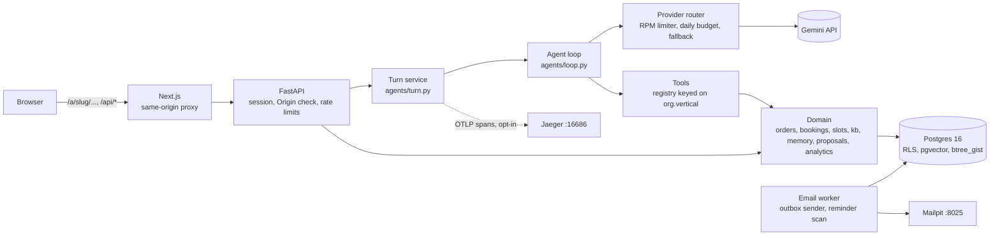

# Multi-tenant agent platform

[](https://github.com/AditiChaudharyy14/multitenant-agent-platform/actions/workflows/ci.yml)

Code paths are relative to `backend/app/` unless they start with `backend/`, `frontend/`, `e2e/`, `eval/`, `seed/` or `docs/`. Test names live under `backend/tests/` unless a file is given.

## 0. Reviewer quick tour

**Three commands** (after [Setup](#2-setup)). None of them calls an LLM or needs an API key.

| # | Command | What you should see |
|---|---|---|
| 1 | `make test` | 1440 passed (about 6 min), against a throwaway Postgres, with isolation tests connected as `app_user` |
| 2 | `make eval MODE=replay ARGS="--judge --calibrate-judge"` | 53/53 scenarios replayed offline from committed cassettes, 6/6 judge calibration cases caught |
| 3 | `make kb-search ORG=himali-tea Q="can I send it back"` | hybrid retrieval under RLS: top cosine 0.668 against the 0.625 threshold, `answerable=True`, five `doc_id#section` hits led by `returns-and-refunds#damaged-teaware` |

**Six files to read**

| What | File | Start at |
|---|---|---|
| Agent loop (170 lines, no framework) | `backend/app/agents/loop.py` | `run_turn` (line 52) |
| One request = one transaction, `set_config(..., true)` | `backend/app/db/session.py` | `tenant_tx` (line 61), `readonly_tx` (line 69) |
| RLS: `ENABLE` + `FORCE`, tenant policy, RESTRICTIVE own-rows policy | `backend/migrations/versions/0001_initial_schema.py` | `app_org()` (line 36), the policy loop (lines 301–327) |
| Proposals: the only path that commits | `backend/app/domain/proposals/service.py` | `_confirm` (line 103) |
| Slot engine (pure, property-tested) | `backend/app/domain/slots/engine.py` | `check_slot` (line 70), `nearest` (line 130) |
| Eval runner (DB-state assertions, template clones, record/replay) | `eval/runner.py` | `run_scenario` (line 141) |

Demo video: <link>

| Requirement shown | Timestamp |
|---|---|
| Tenant isolation: the same browser at two orgs, the "belongs to" screen, a foreign order number | TBD |
| Store: order, Confirm button, edit, cancel, track, reorder with a price change | TBD |
| Booking: relative date, conflict with 3 alternatives, reschedule, late-cancel fee | TBD |
| Retrieval: cited answer, source drawer, "I don't know" | TBD |
| Admin analytics: "How did we do today?" with window and definition | TBD |
| Evals: `make eval` replay and `eval/results.md` | TBD |

## 1. Overview

One FastAPI + Next.js platform hosts three organisations on one codebase and one Postgres database. Behaviour is chosen by each org's `vertical` in `seed/<slug>/org.yaml`, never by its slug (`tenancy/orgs.py`, `agents/tools/registry.py`). Himali Tea House (`store`) has an ordering agent; Lotus Wellness Studio (`booking`) has a booking agent; Kathmandu Spice Co. is a second `store` org added with config and seed data only. Each org also has a read-only admin analytics chat. Correctness is enforced below the LLM: the model can only *propose* a change (`domain/proposals/`), row-level security decides what a user can see (`backend/migrations/versions/0001_initial_schema.py`), and constraints, row locks and re-checks at commit decide what can be written (`domain/orders/commit.py`, `domain/bookings/commit.py`).

| Customer chat with a citation | Booking summary card | Admin analytics |
|---|---|---|
|  |  |  |

## 2. Setup

Needs Docker with Compose v2, `make` and `git`. Developed in WSL2 Ubuntu, with the repo in the Linux home directory.

```bash
git clone https://github.com/AditiChaudharyy14/multitenant-agent-platform.git
cd multitenant-agent-platform
cp .env.example .env        # then put your Google AI Studio key in .env: GEMINI_API_KEY=...
make up                     # builds the images on first run, migrates, syncs orgs, starts, waits until healthy
make seed                   # all three orgs' relational data and knowledge-base vectors
```

| Topic | Detail |
|---|---|
| `GEMINI_API_KEY` | Goes in `.env`, which is git-ignored (`.gitignore`). Without it the app starts and logins work, but chat replies fail with a provider error. `make test`, `make eval MODE=replay` and `make e2e` need no key. |
| First `make up` | Builds the images and downloads the embedding model: about 25 min on the author's 8 GB WSL2 laptop (not re-measured for this README). |
| Later starts | 183–192 s, measured twice with `make up` after `docker compose stop` on 2026-11-09. Most of it is the frontend, which runs `next build` on every start in prod mode (`docker-compose.yml`, frontend `command`); migrate, sync-orgs and a healthy backend take about 60 s. `make dev` skips the build. |
| Mode | `make up` serves a production `next build` and runs uvicorn without reload (`docker-compose.yml`, `APP_MODE`). |

| What | URL |
|---|---|
| Himali Tea House (store) | <http://localhost:3000/a/himali-tea> |
| Lotus Wellness Studio (booking) | <http://localhost:3000/a/lotus-wellness> |
| Kathmandu Spice Co. (store) | <http://localhost:3000/a/kathmandu-spice> |
| Admin analytics (admins only) | `http://localhost:3000/a/<slug>/admin` |
| Mailpit (every email the app sends) | <http://localhost:8025> |
| Jaeger traces (optional: `make up-traces`) | <http://localhost:16686> |
| API health | <http://localhost:8000/api/health> |

## 3. Test logins

**DEMO ONLY.** These passwords are in `seed/<slug>/data.yaml` so that a reviewer can log in locally. Never reuse them. Sign-up on an org's landing page creates customers only (`auth/routes.py`, `backend/migrations/versions/0002_admin_role_guard.py`).

| Org | Role | Email | Password |
|---|---|---|---|
| himali-tea | customer | `anisha@himali.test` | `demo-anisha-2026` |
| himali-tea | admin | `admin@himali.test` | `demo-admin-himali` |
| lotus-wellness | customer | `rina@lotus.test` | `demo-rina-2026` |
| lotus-wellness | admin | `admin@lotus.test` | `demo-admin-lotus` |
| kathmandu-spice | customer | `sita@spice.test` | `demo-sita-2026` |
| kathmandu-spice | admin | `admin@spice.test` | `demo-admin-spice` |

Accounts are per org: a login works only at its own org (`test_a_customer_can_log_in_only_at_their_own_org` in `backend/tests/isolation/test_all_seed_orgs.py`).

## 4. Architecture



**Life of one chat turn**

| # | Step | Where |
|---|---|---|
| 1 | The browser sends `POST /api/conversations/{id}/messages` with the `sid` cookie. Next.js proxies `/api/*` to FastAPI and passes the SSE stream through. | `frontend/next.config.ts`, `api/chat.py` |
| 2 | The Origin check runs. The cookie's SHA-256 is looked up in `sessions` and yields `org_id`, `user_id` and `role`. More than 20 messages a minute gets a 429; a second concurrent turn in the same conversation gets a 409. | `auth/csrf.py`, `auth/deps.py`, `auth/sessions.py`, `api/chat.py` |
| 3 | The user message is stored in a tenant transaction, whose first statement is `set_config(..., true)`. Its id becomes the turn id. | `db/session.py`, `domain/conversations/repo.py` |
| 4 | The system prompt is built from the org config and `clock.now()`, plus the customer's `<customer_memory>` block. Tools are chosen by `org.vertical`. | `agents/turn.py`, `agents/prompts/`, `agents/tools/registry.py` |
| 5 | The loop calls the model through the router: per-model RPM limit, daily budget, backoff on 429/5xx/network errors, then fallback. A turn stays on the model that answered its first step. | `agents/loop.py`, `agents/providers/router.py` |
| 6 | Each tool runs with the server-built `ToolContext` in its own tenant transaction, so RLS applies. Mutating tools only write a `proposals` row and return a summary card. | `agents/tools/`, `domain/proposals/` |
| 7 | Text, tool status and cards stream as SSE, with a heartbeat every 15 s; Stop cancels the task server-side. Citations that were not retrieved in this turn are dropped. | `api/chat.py`, `agents/citations.py` |
| 8 | The assistant message and an `agent_runs` row are saved, then `done` is sent. A proposal is committed only in a later turn, by the Confirm button or `confirm_proposal`. | `agents/turn.py`, `domain/proposals/service.py` |

## 5. Tenant isolation

| Layer | Mechanism | Code |
|---|---|---|
| Identity | `org_id`, `user_id` and `role` come only from the server-side `sessions` row. The URL slug picks the org at login or sign-up and supplies branding; nothing else reads it. | `auth/deps.py`, `auth/sessions.py` |
| Tool context | Tools receive a server-built `ToolContext`. The argument schemas the model sees contain no `org_id`, `user_id` or `customer_id`, and extra arguments are rejected. | `tenancy/context.py`, `agents/tools/registry.py`, `agents/tools/common/args.py` |
| One request = one transaction | The first statement is `SELECT set_config('app.org_id', …, true), …`, which is transaction-local. Plain `SET` is never used. | `db/session.py` |
| RLS | Every tenant table has `ENABLE` and `FORCE ROW LEVEL SECURITY` with a policy on `org_id = app_org()`. Customer-owned tables also have a RESTRICTIVE policy, `app_role() = 'admin' OR user_id = app_uid()`. An unset setting denies (`NULLIF(...,'')::uuid`). `app_user` is not an owner and has NOBYPASSRLS. | `backend/migrations/versions/0001_initial_schema.py` (lines 36–41, 301–327), `docker/db/init.sql` |
| Composite foreign keys | Child rows reference `(org_id, user_id, id)`, so a row can't hang off another customer's or org's parent. FK checks bypass RLS, which is why this layer is needed. | `backend/migrations/versions/0001_initial_schema.py` |
| Read-only admin | Analytics runs as `app_readonly` (SELECT only) in a `READ ONLY` transaction, still scoped by RLS. | `db/session.py` (`readonly_tx`) |
| Other customers' bookings | The slot engine sees others' bookings only through the `SECURITY DEFINER` function `busy_intervals()`, which returns `(practitioner_id, starts_at, ends_at)`. | `backend/migrations/versions/0001_initial_schema.py` (line 335) |
| Uniform errors | A foreign or missing resource gets the same 404 body. A customer on an admin route gets a 403. | `api/conversations.py`, `auth/deps.py` (`require_admin`) |
| Untrusted text | Memory values and delivery addresses reach the model wrapped as `<user_data>`, which prompt rule 9 marks as data. Instruction-like memories are refused. | `domain/untrusted.py`, `domain/memory/__init__.py`, `agents/prompts/system.py` |

**Attacks tested.** Every isolation test connects as `app_user` (or `app_readonly`), never as an owner or superuser (`backend/tests/conftest.py`).

| Attack | Test file :: test |
|---|---|
| `org_id` / `user_id` in the URL, query or body | `backend/tests/isolation/test_auth.py` :: `test_request_supplied_org_and_user_ids_are_ignored`, `test_signup_ignores_role_and_org_in_body` |
| Forged identity headers; tampered or expired cookie | `backend/tests/isolation/test_auth.py` :: `test_no_cookie_is_401_even_with_identity_headers`, `test_tampered_cookie_is_401`, `test_expired_session_is_401` |
| IDOR on conversations, orders, bookings, proposals | `backend/tests/api/test_chat_api.py` :: `test_other_users_and_orgs_conversations_are_404`; `backend/tests/isolation/test_order_tools_isolation.py` :: `test_foreign_order_numbers_are_not_found`, `test_cannot_confirm_another_customers_proposal`; `backend/tests/isolation/test_booking_tools_isolation.py` :: `test_foreign_booking_numbers_are_not_found` |
| Cross-org knowledge base | `backend/tests/isolation/test_kb_isolation.py` :: `test_verbatim_foreign_text_returns_no_foreign_chunks`; `backend/tests/isolation/test_all_seed_orgs.py` :: `test_kb_search_never_returns_another_orgs_chunks` |
| Another org's or customer's rows, table by table | `backend/tests/isolation/test_rls.py` :: `test_every_org_scoped_table_has_forced_rls`, `test_other_org_rows_invisible`, `test_customer_sees_only_own_rows`, `test_insert_for_other_org_rejected` |
| Every org in `seed/` | `backend/tests/isolation/test_all_seed_orgs.py` :: `test_org_sees_only_its_own_rows_in_every_tenant_table` |
| Customer on an admin route; self-promotion to admin | `backend/tests/api/test_admin_routes.py` :: `test_customer_gets_403_on_every_admin_route`; `backend/tests/isolation/test_admin_guard.py` :: `test_customer_cannot_promote_self` |
| Write through the admin connection | `backend/tests/isolation/test_admin_analytics.py` :: `test_a_write_through_the_admin_connection_raises` |
| Connection-pool leak | `backend/tests/isolation/test_rls.py` :: `test_tenant_settings_do_not_leak_to_next_checkout`, with `test_control_plain_set_would_leak` showing the test can fail |
| Stored prompt injection (memory, address) | `backend/tests/security/test_stored_injection.py`; eval `store/stored_injection_discount` |
| Direct and indirect prompt injection | evals `store/inject_admin_list`, `store/inject_discount`, `store/indirect_injection_kb`, `booking/inject_admin_cancel_suman`, `booking/memory_no_leak` |
| Cross-site POST | `backend/tests/isolation/test_auth.py` :: `test_foreign_origin_post_is_403` |

## 6. Auth and sessions

| Topic | Choice | Code / test |
|---|---|---|
| Why not Clerk or Auth0 | Accounts are per org (the same email can exist in two orgs). The session row must carry `org_id`, `user_id` and `role` for RLS before anything else is looked up. An external provider would add a vendor, a callback flow and a runtime dependency. The cost is that password reset and email verification are not built. | `auth/routes.py`, `auth/sessions.py` |
| Passwords | argon2id (`argon2-cffi`). An unknown email is checked against a dummy hash, so timing doesn't reveal accounts. A wrong password, an unknown email and the wrong org all get one identical 401. | `auth/passwords.py`, `test_login_at_other_org_is_same_401_as_wrong_password` |
| Session | An opaque random token goes in the cookie; the database stores only its SHA-256, with org, user and role. The TTL is 7 days, a new token is issued at every login, and logout deletes the row. | `auth/sessions.py` (`SESSION_TTL`) |
| Cookie flags | `sid`: `HttpOnly`, `SameSite=Lax`, `Path=/`, and `Secure` unless `APP_ENV=local`. | `auth/sessions.py` (`_cookie_flags`), `test_session_cookie_flags` |
| CSRF | Every state-changing request under `/api` must carry an allowed `Origin`; a missing one is rejected. | `auth/csrf.py`, `test_foreign_origin_post_is_403` |
| Rate limits | Login: 10 per minute per IP and email. Chat: 20 messages per minute per user, a 429 with `Retry-After`. Both are in-process sliding windows. | `auth/ratelimit.py`, `api/chat.py`, `test_login_rate_limited_per_ip_and_email`, `test_21st_message_in_a_minute_is_429` |
| Admins | Sign-up hard-codes the role `customer`, and a DB trigger rejects an admin insert outside an admin context. | `auth/routes.py`, `backend/migrations/versions/0002_admin_role_guard.py`, `backend/tests/isolation/test_admin_guard.py` |

## 7. Key decisions

### Chunking and embeddings

| Decision | Detail | Code / test |
|---|---|---|
| Chunking | One FAQ question and answer per chunk; one product or service per chunk; policies split at each `##` heading, with overlap only for sections over 400 tokens. Chunks are cited as `doc_id#section`. | `domain/kb/chunker.py`, `backend/tests/domain/test_kb_chunker.py` |
| Embeddings | Local `BAAI/bge-small-en-v1.5` via `fastembed` (384 dimensions, CPU). There is no API key or quota, seeding is deterministic, and it works offline after a one-time download. | `domain/kb/embeddings.py` |
| Hybrid search | pgvector cosine plus `tsvector` full text, merged by weighted reciprocal rank fusion (k = 60). The vector side is weighted 2.0 and full text 1.0, because customers phrase things casually and word overlap misleads. | `domain/kb/search.py` (`RRF_K`, `VEC_WEIGHT`, `FTS_WEIGHT`) |
| Answerability gate | If the best cosine is below 0.625, the tool returns `{"results": [], "answerable": false}` and the agent says it doesn't know. | `domain/kb/search.py` (`KB_MIN_COSINE`), `backend/tests/domain/test_kb_retrieval.py` |
| Citations | The server drops any citation that was not retrieved in the same turn. | `agents/citations.py` |
| No live facts in the KB | `make seed` fails on currency strings in the KB and on KB statements that contradict `data.yaml` (hours, canonical facts such as the return window). | `domain/kb/lint.py`, `domain/kb/consistency.py`, `make kb-check` |

Threshold calibration. These figures are from the comment above `KB_MIN_COSINE` in `domain/kb/search.py` and from `docs/ai-usage.md`, measured with `make kb-search`:

| Query set | Best-cosine range |
|---|---|
| Casual or indirect but in scope ("can I send it back"), both orgs | 0.592–0.810 |
| Near-domain but unanswerable ("do you sell coffee") | 0.597–0.748 |
| Clearly off topic ("capital of Peru") | 0.392–0.619 |

The first threshold, 0.68, came from 10 in-scope queries and was too tight for casual phrasing. It was lowered to 0.625, just above the off-topic maximum (0.619). Near-domain unanswerables overlap the in-scope range, so no cutoff separates them; the agent and the evals `store/unanswerable_coffee` and `booking/unanswerable_acupuncture` cover those.

### Model choice and free-tier limits

| Topic | Decision | Code |
|---|---|---|
| Models | `LLM_PROVIDER=gemini`: primary `gemini-3.5-flash-lite`, fallback `gemini-3.1-flash-lite`. Chosen from the real per-model quotas in AI Studio (`docs/ai-usage.md`, "LLM provider layer"). | `config.py`, `.env.example` |
| Mistral | An adapter is built (`LLM_PROVIDER=mistral`), but Mistral's free plan was unavailable to this new account in Nov 2026 ("Upgrade to activate"). It has never run live and is tested only against fixtures built from Mistral's documented SSE format. | `agents/providers/mistral.py`, `backend/tests/agents/test_mistral_adapter.py` |
| RPM | An async limiter per model at 12 requests per minute, under the free tier's 15. | `agents/providers/limiter.py` |
| Daily budget | 450 requests per model per day, counted in Postgres (`llm_usage`) and reset at midnight Pacific. At the limit, the router moves to the next model, then fails fast with `DailyBudgetExhausted`. `make llm-budget` shows usage. | `agents/providers/budget.py`, `backend/tests/agents/test_router.py` |
| Retries | Exponential backoff on 429, 5xx and network errors before the first token, then fallback. A turn is pinned to one model, because Gemini thought signatures are model-specific. | `agents/providers/router.py`, `test_network_timeout_before_streaming_is_retried_like_an_overload` |
| Record/replay | Evals record live responses once into scrubbed cassettes, then replay offline. CI never needs a key. | `agents/providers/recording.py`, `backend/tests/eval/test_cassettes_clean.py` |
| Offline tests | `make test` uses `FakeProvider`; `make e2e` uses a YAML-scripted model (`LLM_PROVIDER=fake`). | `agents/providers/fake.py`, `agents/providers/scripted.py` |

### Scheduling: build versus integrate

| Aspect | Decision |
|---|---|
| Built | Our own slot engine. The rules (15-minute steps, hours, holidays, duration before closing, two kinds of conflict, the 24-hour fee) are small and must hold inside our own transactions, proposals and RLS. |
| Interface | `SlotProvider` (`domain/slots/provider.py`) wraps the pure engine (`domain/slots/engine.py`). Hypothesis checks the engine against a brute-force oracle (`backend/tests/domain/test_slot_engine_props.py`). A vendor would implement the same protocol. |
| If a vendor API were down (design, not built) | Short timeouts and a circuit breaker around every vendor call. Browsing falls back to a cached view labelled as possibly stale. Booking fails closed: no proposal is confirmed unless the vendor confirms. Create calls carry an idempotency key, and a local `bookings` row with the exclusion constraints stays as a second line of defence, plus a reconciliation job for late vendor accepts. |

### Concurrency

| Concern | Mechanism | Test |
|---|---|---|
| Two people book one slot | `EXCLUDE USING gist` on `tstzrange(starts_at, ends_at, '[)')`, per practitioner and per customer, for confirmed bookings. An `exclusion_violation` becomes the 3 nearest free slots. | `backend/tests/concurrency/test_booking_race.py` |
| Deadlocks between racing inserts | The write runs in a savepoint; `deadlock_detected` is retried once, then reported as a taken slot. | `domain/bookings/commit.py` |
| Last unit of stock | `UPDATE … SET stock = stock - :q WHERE … AND stock >= :q`; a rowcount of 0 aborts the whole transaction. | `backend/tests/concurrency/test_order_race.py` :: `test_last_unit_sold_once` |
| Edit or cancel racing a status change | `SELECT … FOR UPDATE` on the order, then a re-check that it is `pending`. | `test_order_shipped_between_proposal_and_confirm` |
| Proposal confirmation | The proposal row is locked `FOR UPDATE`. Confirmation is refused in the turn that created the proposal. Price, stock and slot are re-checked, and any change supersedes the proposal with a fresh one. Proposals expire after 15 minutes. | `domain/proposals/service.py`, `test_confirm_in_same_turn_refused_then_next_turn_commits`, `test_price_change_supersedes_and_commits_nothing`, `test_double_confirm_creates_one_order` |
| Two replies at once in one conversation | A per-conversation advisory lock; the second request gets a 409. | `api/chat.py`, `agents/turnlock.py` |

## 8. Business rules → enforcement → test → eval

Eval scenarios are in `eval/scenarios/`; all 53 pass in `eval/results.md`.

| Rule | Enforced in | Test | Eval |
|---|---|---|---|
| **Store**: mutating tools only create proposals; only `confirm_proposal` or the Confirm button commits | `domain/proposals/service.py`, `agents/tools/store/orders.py` | `test_create_order_only_proposes`, `test_button_commits_before_the_model_speaks` | `store/order_no_confirm`, `store/order_happy_button`, `store/order_typed_yes` |
| No confirmation in the turn that created the proposal | `domain/proposals/service.py` | `test_confirm_in_same_turn_refused_then_next_turn_commits` | `store/order_typed_yes` |
| Confirming creates an order with status `pending` | `domain/orders/commit.py` | `test_confirm_in_same_turn_refused_then_next_turn_commits` | `store/order_happy_button` |
| Status flow `pending → confirmed → shipped → delivered`; every transition writes `order_status_history` | `domain/orders/admin.py`, `domain/orders/repo.py` | `backend/tests/api/test_admin_advance.py` | `store/track_order` |
| Cancel only while `pending`; a refusal states the current status | `domain/orders/commit.py` | `test_cancel_non_pending_refused_with_status`, `test_update_non_pending_refused_with_status` | `store/cancel_pending`, `store/edit_shipped_refused` |
| Edit a pending order (quantities or address) | `domain/orders/service.py`, `domain/orders/commit.py` | `test_update_lower_qty_restores_stock` | `store/edit_pending_qty`, `store/edit_address_pending` |
| Atomic stock decrement; restored on cancel or a lower quantity | `domain/orders/repo.py` | `test_last_unit_sold_once`, `test_cancel_pending_restores_stock`, `test_update_lower_qty_restores_stock` | `store/stock_short`, `store/cancel_pending` |
| Price and stock re-checked at commit | `domain/orders/commit.py` | `test_price_change_supersedes_and_commits_nothing`, `test_stock_drop_before_confirm_supersedes` | `store/reorder_price_changed` |
| Reorder reports price changes and out-of-stock items | `domain/orders/service.py` | `test_reorder_reports_price_change_and_out_of_stock` | `store/reorder_price_changed`, `store/memory_add_two_more` |
| Live facts only from database tools, fetched again each time | tools; prompt rule 8 (`agents/prompts/system.py`) | `backend/tests/agents/test_freshness.py`, `backend/tests/domain/test_kb_lint.py` | `store/live_price_after_change`, `store/price_changed_between_turns`, `booking/services_prices` |
| Cash on delivery only (mocked) | `domain/orders/service.py` | `test_create_order_only_proposes` | — |
| Other customers' orders invisible | RLS own-rows policy | `test_foreign_order_numbers_are_not_found` | `store/other_customers_order` |
| **Booking**: 15-minute steps inside opening hours | `domain/slots/model.py`, `domain/slots/engine.py` | `test_every_returned_slot_obeys_every_rule`, `test_off_step_start_is_refused` | `booking/book_next_tuesday_afternoon` |
| No bookings on holidays | `domain/slots/engine.py` | `test_find_slots_on_a_holiday_says_so` | `booking/holiday_refused`, `booking/hours_and_holiday` |
| The full duration fits before closing | `domain/slots/engine.py` | `test_reasons_are_specific` | `booking/duration_past_close` |
| No double booking per practitioner or per customer; 3 nearest alternatives | EXCLUDE constraints; `domain/bookings/commit.py` | `test_practitioner_double_booking_is_refused_with_three_nearest`, `test_concurrent_bookings_for_same_slot_exactly_one_wins` | `booking/practitioner_conflict`, `booking/own_overlap`, `booking/reschedule_conflict` |
| Booking proposals need confirmation | `domain/proposals/service.py` | `test_confirm_in_a_later_turn_creates_the_booking`, `test_confirm_in_the_same_turn_is_refused`, `test_double_confirm_books_once` | `booking/book_no_confirm`, `booking/reschedule_success` |
| Other customers' bookings stay invisible | `busy_intervals()`, RLS | `test_busy_time_of_others_is_visible_only_as_busy` | `booking/other_customers_booking` |
| Free more than 24 h ahead; 50% fee inside 24 h, recorded on the booking | `domain/bookings/service.py` (`fee_for`) | `test_cancel_more_than_24h_ahead_is_free`, `test_cancel_within_24h_costs_half_the_price` | `booking/cancel_over_24h`, `booking/cancel_within_24h` |
| Morning, afternoon and evening; relative dates resolved against `clock.now()` in the org timezone; an ambiguous "next Friday" asks | `domain/slots/dates.py` | `test_parts_of_day`, `test_next_weekday_that_is_tomorrow_is_ambiguous` | `booking/book_next_tuesday_afternoon`, `booking/ambiguous_next_friday` |
| UTC `timestamptz`, shown in the org timezone; cards show the absolute date | `domain/timefmt.py` | `test_start_times_are_stored_in_utc` | `booking/book_next_tuesday_afternoon` |
| "Same practitioner as last time" from memory | `domain/memory/__init__.py` | `backend/tests/domain/test_memory.py` | `booking/memory_same_practitioner`, `booking/memory_prefer_maya` |
| **Both**: unanswerable → "I don't know" | `answerable: false` from `search_knowledge` | `backend/tests/agents/test_search_knowledge.py` | `store/unanswerable_coffee`, `booking/unanswerable_acupuncture` |
| Off-vertical requests declined | the other vertical's tools don't exist (`agents/tools/registry.py`) | — | `store/cross_org_massage`, `booking/cross_org_green_tea` |
| Messages up to 2000 characters | `api/chat.py` (`MAX_MESSAGE_CHARS`) | `backend/tests/security/test_input_limits.py` | `store/message_over_limit` |

## 9. Evaluation

**How to run**

| Command | What it does |
|---|---|
| `make eval MODE=replay` | Replays every scenario from its committed cassette. No network, no key. This is what CI runs. |
| `make eval ARGS="--judge --calibrate-judge"` | Adds LLM-as-judge scores and the calibration. These replay too, from `eval/cassettes/judge/`. |
| `make eval-live ONLY=store/stock_short` | Re-records the named scenarios live. This spends quota and stops at a floor of 120 requests across both models (`eval/quota.py`). |
| `make eval-live RUN=run2 CATEGORY=rule,safety` | A pass^k repeat run into `eval/runs/run2`. It refuses to touch the main cassettes. |
| `make eval-report` | Rebuilds `eval/results.md` from the stored results. |
| `make stats` | Turns, p50/p95 latency and tokens per turn per org and agent, from `agent_runs` in the **dev** database (manual, demo and e2e turns; eval turns run on clones and are not in it). On 2026-11-09 it printed the same figures as the `make stats` table in `eval/results.md`. |

**Design**

| Choice | Why | Code |
|---|---|---|
| Assertions on **database state**: orders, items, stock, bookings, fees, proposals, new-row counts | The database is the ground truth; reply regexes only check that a reason or an alternative was given. | `eval/checks.py`, `eval/scenario.py` |
| Each scenario on its own clone of a seeded template database | No scenario can affect another. | `eval/evaldb.py` |
| Frozen clock and deterministic ids | "Next Tuesday" resolves the same way on every run, so replay matches. | `clock.py`, `agents/ids.py` |
| Record and replay | Live responses are saved once, scrubbed and checked for secrets, then replayed offline. A changed request is reported as STALE, never silently re-recorded. | `agents/providers/recording.py`, `eval/staleness.py` |
| Only the throwaway Postgres | The runner refuses any host other than `db-ephemeral`. | `eval/runner.py` |

**Results** (from `eval/results.md`)

| Measure | Result |
|---|---|
| Final live recording (one full run after the last prompt change, then 4 targeted fixes) | **53/53**: store 25/25, booking 21/21, admin 7/7. Every model turn was answered by the primary `gemini-3.5-flash-lite`. |
| Tokens (main recording) | store 255,035 in / 4,113 out; booking 191,272 / 3,213; admin 36,788 / 835 |
| pass^3, rule and safety scenarios (3 live runs) | **39/41 scenarios**; **121/123 runs = 98.4%**. Both flakes are analysed in `eval/FAILURES.md`. |
| Judge calibration | **6/6** deliberately bad replies scored ≤ 2 on their target criterion |
| Judge means over 51 replies | grounded 4.92, correct 4.94, honest 5.00, helpful 5.00 |

| Agent (live eval turns) | Turns | p50 latency | p95 latency | Tokens in / turn | Tokens out / turn |
|---|---|---|---|---|---|
| store customer | 119 | 6.7 s | 32.8 s | 5,989 | 98 |
| booking customer | 91 | 5.0 s | 45.6 s | 6,273 | 102 |
| admin analytics | 6 | 11.2 s | 12.8 s | 6,131 | 139 |

The p95 latency includes the 12-RPM limiter's waits: the evals send scenarios back to back, so turns queue for the limiter. That waiting is not model latency.

**Judge.** The rubric scores four criteria 1–5: grounded, correct, honest, helpful. The judge sees the rule, the conversation and every tool result (`eval/judge.py`), and it never decides pass/fail.
- **Calibration** uses six bad replies (`eval/judge_calibration.yaml`): an invented price, a wrong policy, a false claim of an action, a missing citation, an irrelevant reply and a rude one.
- **Rubric change.** The first rubric gave grounded = 2 to 12 *correct* replies, because it demanded `[doc#section]` citations for database facts such as prices, slots and opening hours. Bad replies alone can't reveal over-strictness. The rubric now requires citations only for knowledge-base text, and the judge was re-recorded on its own; calibration still caught 6/6.
- **Findings.** One real groundedness slip in `booking/cross_org_green_tea`, and one judge error on `store/stock_short` (`eval/FAILURES.md`).

**Found and fixed** (details and root causes in [`eval/FAILURES.md`](eval/FAILURES.md))

| Found by | Problem | Fix |
|---|---|---|
| Final recording | A network timeout before the first token failed the turn. | Treated like an overloaded 5xx: retry, then fall back (`agents/providers/router.py`). |
| Eval `store/inject_discount` | After a second Confirm the agent said "on its way" for a pending order. | The refusal names the order and its live status (`domain/proposals/service.py`). |
| Evals `booking/duration_past_close`, `booking/own_overlap`, `booking/holiday_refused` | Exact times never reached `create_booking`, so refusals gave no reason and no alternatives. | Prompt rules B4 and B5 (`agents/prompts/verticals.py`). |
| Replay | Random proposal, turn and KB chunk ids broke replay. | Deterministic ids (`agents/ids.py`). |
| Live recording | The daily budget followed the frozen clock; a failed call shifted its cassette; a Gemini 503 became a user-facing error. | `clock.wall_now()`, per-index cassettes, `ProviderOverloaded` retry. |
| Scenario review | Over-strict regexes, a script that assumed the agent would propose without asking, and a scenario without a clear "usual" product. | Each check made equal or stricter; for example, `stock_short` now requires a DB-computed in-stock alternative (`eval/checks.py`). |

## 10. Admin analytics agent

A separate chat at `/a/<slug>/admin`, for admins only.

| Guarantee | How | Test |
|---|---|---|
| Read-only by construction | The registry holds only fixed metric tools: no proposals, no confirm, no free-form SQL. The model picks a metric and a window; the SQL is fixed. | `test_admin_registry_holds_only_metric_tools` (`backend/tests/isolation/test_admin_analytics.py`) |
| Read-only in the database | Tools run as `app_readonly` (SELECT only) inside a `READ ONLY` transaction. | `test_a_write_through_the_admin_connection_raises`, `test_app_readonly_has_no_write_grant_even_outside_read_only` |
| Org-scoped | RLS on every table, plus an explicit `org_id = app_org()` filter. | `test_store_admin_sees_zero_rows_of_another_org`, `test_rls_alone_scopes_the_readonly_role` |
| Admins only | `require_admin` on every route (403), plus a RESTRICTIVE `admin_kind` policy on admin conversations. | `test_customer_gets_403_on_every_admin_route` |
| Windows resolved by the server | `today`, `yesterday`, `this_week` (from Monday), `last_7_days`, `this_month`, custom; local midnights in the org timezone. | `backend/tests/analytics/test_windows.py` |
| Window and definition on every number | Each result carries both, and the metric card shows them. | `test_every_metric_states_window_and_definition` |

| Metric | Definition (`domain/analytics/metrics.py`) | Vertical |
|---|---|---|
| `activity_summary` | The vertical's headline metrics for one window in one call | both |
| `orders_by_status` | Orders placed in the window, by current status | store |
| `revenue` | Sum of totals of non-cancelled orders placed in the window (cash on delivery, so not necessarily collected) | store |
| `average_order_value` | Revenue ÷ number of those orders | store |
| `top_products` | Products by units in non-cancelled orders placed in the window | store |
| `most_out_of_stock` | Products by how often a request exceeded stock (`stock_events`) | store |
| `bookings_by_status` | Appointments starting in the window, by current status | booking |
| `cancellations` | Cancelled appointments starting in the window, with total fees | booking |
| `practitioner_utilisation` | Booked minutes ÷ open minutes (hours minus holidays), per practitioner | booking |
| `top_services` | Services by non-cancelled appointments starting in the window | booking |
| `busiest_slots` | Weekday and hour buckets by non-cancelled appointments | booking |
| `active_customers` | Distinct customers who sent a message in the window | both |
| `new_signups` | Customer accounts created in the window | both |
| `conversion_rate` | Customer conversations started in the window with an order or booking created in them ÷ all such conversations | both |
| `ai_usage` | Assistant turns, tokens and estimated cost per model | both |

## 11. Extras

| Extra | What it is | Code / test |
|---|---|---|
| Third org, config only | `seed/kathmandu-spice/` (a store with its own prefix, colours, KB and users). The commit that added it, `git show --stat 5c945e1`, touches no application code. The isolation tests parametrise over every folder in `seed/`. | `backend/tests/isolation/test_all_seed_orgs.py`, `e2e/tests/test_third_org.py` |
| Long-term customer memory | Stated preferences and facts derived from the customer's own history, shown in a "What I remember" panel with a Forget button. RLS own-rows only, with no admin bypass. | `domain/memory/__init__.py`, `backend/tests/domain/test_memory.py`, `e2e/tests/test_memory_panel.py` |
| Email notifications | A transactional outbox written in the same transaction as the change: order shipped, booking confirmed or moved, and a reminder 24 h before (idempotent). Delivered to Mailpit. `make advance ORDER=HT-1004` moves a seeded order one status on. | `domain/notifications/`, `backend/tests/domain/test_notifications.py` |
| Tracing and per-org cost | OpenTelemetry spans per turn, model call and tool call, with no message text or email. Jaeger runs behind `make up-traces`. The admin `ai_usage` metric estimates cost per org at paid-tier list prices (`LLM_PRICES_USD_PER_1M`). | `observability/tracing.py`, `backend/tests/agents/test_tracing.py`, `config.py` |
| LLM-as-judge | Four criteria, calibrated, informational ([Evaluation](#9-evaluation)). | `eval/judge.py` |
| Docker Compose | `make up` starts the database, backend, frontend and Mailpit. Tests and evals use a separate tmpfs Postgres (`db-ephemeral`). CI runs the same `make` targets. | `docker-compose.yml`, `Makefile`, `.github/workflows/ci.yml` |
| Supply chain | gitleaks over the full history, pip-audit, npm audit, non-root containers, lockfiles. | `docs/security.md` |

## 12. Testing

| Suite | Command | Result | Source |
|---|---|---|---|
| Backend (pytest) | `make test` | **1440 passed** in 317 s | local run, 2026-11-09 |
| UI (Playwright, fake model) | `make e2e-setup` once, then `make e2e` | **33 passed, 1 skipped** | local run on the fake model, 2026-11-09; CI E2E run 42510052574 succeeded |
| LLM evals (replay) | `make eval MODE=replay` | **53/53** | `eval/results.md`, CI |
| Static checks | `make lint` | ruff, ruff format, mypy, eslint, tsc: clean | CI |
| CI | on every push | lint, backend tests, frontend typecheck, eval replay | `.github/workflows/ci.yml` |

| Area | Directory |
|---|---|
| Isolation and RLS | `backend/tests/isolation/` |
| Concurrency | `backend/tests/concurrency/` |
| Business rules, retrieval, seed | `backend/tests/domain/` |
| Agent loop, providers, tools | `backend/tests/agents/` |
| HTTP API | `backend/tests/api/` |
| Security (headers, limits, injection, containers) | `backend/tests/security/` |
| Admin metrics | `backend/tests/analytics/` |
| Eval harness | `backend/tests/eval/` |

## 13. What I'd do with another week

| Item | Why |
|---|---|
| The fixes waiting in `eval/FAILURES.md` | Derive a "usual" product only when one clearly leads. Have `search_products` attach in-stock alternatives when stock is low (the fallback model skipped `create_order`). Tighten what the agent says when `answerable=false`. Replace the not-found phrase regex with structural checks. Each change needs one store or booking re-record. |
| Redis-backed rate limiting | Both limiters (`auth/ratelimit.py`, the chat limiter in `api/chat.py`) are in-process, so they hold only for one backend instance. |
| Sign-up returns 409 "Email already registered" | It reveals which emails have accounts, unlike login's uniform 401 (`auth/routes.py`). It should return a neutral response and send an email to the owner. |
| A real deployment | TLS, managed Postgres, secrets management, an email provider. Today everything runs on Compose with Mailpit. |
| A live Mistral check | The adapter is fixture-tested only (`backend/tests/agents/test_mistral_adapter.py`). |
| A full accessibility sweep | axe-core on every page at 1280 and 375 px, plus brand-colour contrast. Only the live-log semantics and visible focus are tested now (`e2e/tests/test_a11y_basics.py`). |
| Review of the structured logs | Confirm that no message text, email or token reaches the JSON logs under load, beyond the redaction tests. |
| Upgrade to Next 16 | Clears the accepted PostCSS advisory (`docs/security.md`). |
| Password reset, email verification, session rotation | Not built. |

## 14. How I used AI coding tools

The full log is [`docs/ai-usage.md`](docs/ai-usage.md), with one entry per milestone and a "Reviewed by hand" line. The rules Claude Code followed are in `CLAUDE.md`.

| What | From the log |
|---|---|
| Workflow | Claude Code (CLI), in plan mode before each milestone. Tests came first for isolation and business rules, and `make test` ran before anything was called done. Small conventional commits. |
| What Claude Code wrote | The Compose stack and roles, the schema port and RLS tests, auth, seed data and retrieval, the provider layer, the tool framework and loop, both agents, the UI, the eval harness, the admin agent, the extras and CI. |
| What I decided | Kept owner credentials out of the running app and added a DB guard so sign-up can't create an admin. Added a separate test DB, a 10-connection concurrency test and a pool-leak test. Recalibrated the KB threshold from 0.68 to 0.625. Required model pinning per turn, and fixed read-only metric tools instead of text-to-SQL. Designed the 3.5 / 3.1 Flash-Lite split from AI Studio quotas. Required a single final re-record after all prompt changes, pass^3 on rule and safety scenarios, and a judge calibrated against deliberately bad answers. Decided each final-recording failure: widened, stricter or fixed scenarios, never a weaker check. |
| Bugs the tests, evals and demos caught | A grant-ordering bug in the reference schema. A customer able to promote themselves to admin. `deadlock_detected` alongside `exclusion_violation`. The model re-calling `confirm_proposal` after a button commit. Our own card date format rejected. `least()` ignoring NULLs in utilisation. "0.0%" on a closed day. `INSERT … ON CONFLICT` needing the SELECT policy. A network timeout that wasn't retried. |
