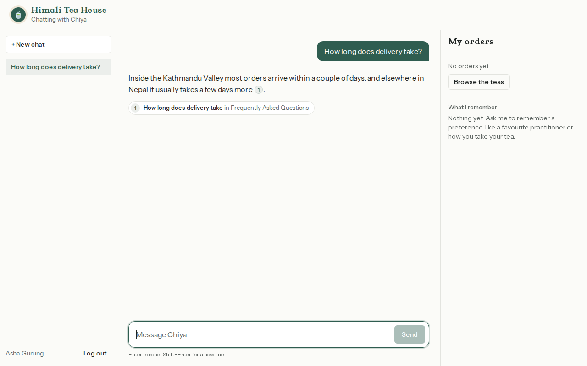
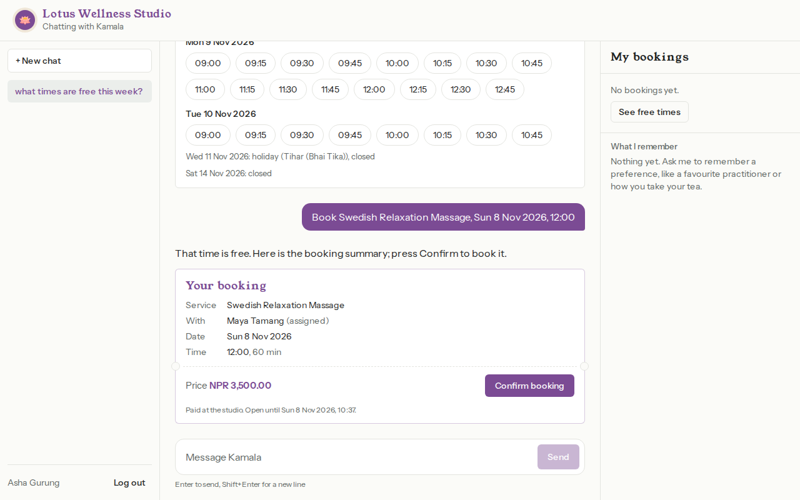
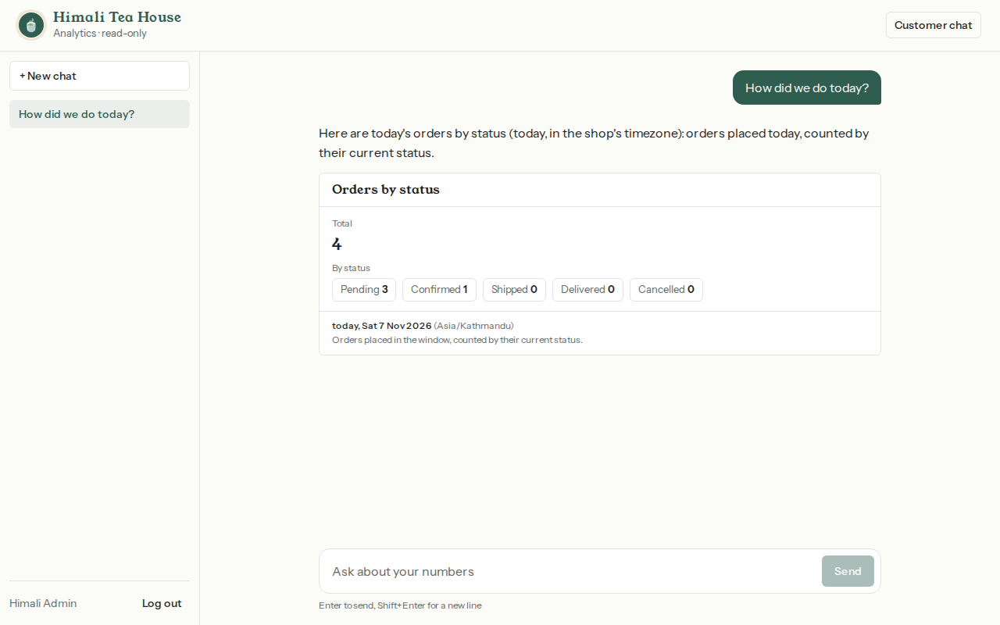
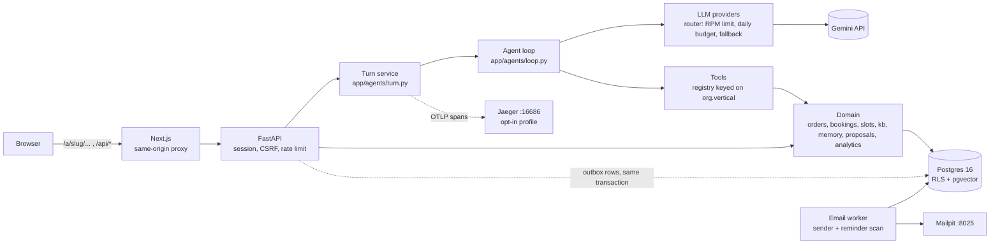

# Multi-tenant agent platform

## 1. Overview

One chat platform hosts three AI-agent businesses on one codebase and one Postgres database:

| Org | Slug | Vertical | Agent covers |
|---|---|---|---|
| Himali Tea House | `himali-tea` | `store` | product Q&A, order life cycle (create, edit, track, cancel, reorder) |
| Lotus Wellness Studio | `lotus-wellness` | `booking` | service Q&A, appointments (book, reschedule, cancel) with no conflicts |
| Kathmandu Spice Co. | `kathmandu-spice` | `store` | same as Himali; added with config and seed data only (see [Extras](#11-extras)) |

Plus a read-only admin analytics chat per org. The design rule: **correctness is enforced below the LLM**. The model can only *propose* a change; the database, not the prompt, decides what a user may see (row-level security) and what may be written (constraints, row locks, re-checks at commit).

| Customer chat | Order summary card | Admin analytics |
|---|---|---|
|  |  |  |

## 2. Setup

Needs Docker (Compose v2) and `make`. Developed in WSL2 Ubuntu with the repo in the Linux home directory.

```bash
git clone https://github.com/AditiChaudharyy14/multitenant-agent-platform.git
cd multitenant-agent-platform
cp .env.example .env     # then set GEMINI_API_KEY=... in .env (free key from Google AI Studio)
make up                  # builds images on first run, migrates, syncs orgs, starts everything, waits until healthy
make seed                # loads all three orgs' data and knowledge-base vectors
```

- `GEMINI_API_KEY` goes in `.env` (git-ignored). Without it the app runs but chats fail with a provider error; `make test`, `make e2e` and `make eval` (replay) need no key.
- **The first `make up` is slow: about 25 to 30 minutes**, measured from a fresh clone on a WSL2 VM with 5 GB of RAM. It builds the frontend image (`npm ci`, about 8 min) and the backend image (about 5 min); then the backend downloads the embedding model (about 130 MB) and reports healthy only once it is loaded (`backend/app/api/health.py`). `make seed` took under 2 minutes. Later `make up` runs take seconds.
- `make up` runs **production mode**: the frontend serves a production `next build` (built when the container starts, about 5 minutes including the backend's model warm-up on this machine) and uvicorn runs without reload, so pages load in well under a second. For working on the code, `make dev` runs `next dev` and `uvicorn --reload` instead (pages then compile on their first visit).

| What | URL |
|---|---|
| Himali Tea House | <http://localhost:3000/a/himali-tea> |
| Lotus Wellness Studio | <http://localhost:3000/a/lotus-wellness> |
| Kathmandu Spice Co. | <http://localhost:3000/a/kathmandu-spice> |
| Admin analytics (admins only) | `http://localhost:3000/a/<slug>/admin` |
| Mailpit (every email the app sends) | <http://localhost:8025> |
| Jaeger traces (optional, `make up-traces`) | <http://localhost:16686> |
| API health | <http://localhost:8000/api/health> |

## 3. Test logins

**DEMO ONLY.** These passwords come from `seed/<slug>/data.yaml`, exist so a reviewer can log in locally, and must never be reused. Anyone can also sign up as a new customer on an org's landing page; sign-up can only create customers.

| Org | Role | Email | Password |
|---|---|---|---|
| himali-tea | customer | `anisha@himali.test` | `demo-anisha-2026` |
| himali-tea | admin | `admin@himali.test` | `demo-admin-himali` |
| lotus-wellness | customer | `rina@lotus.test` | `demo-rina-2026` |
| lotus-wellness | admin | `admin@lotus.test` | `demo-admin-lotus` |
| kathmandu-spice | customer | `sita@spice.test` | `demo-sita-2026` |
| kathmandu-spice | admin | `admin@spice.test` | `demo-admin-spice` |

More customers are in the same files. Accounts are per org: the same email can exist in two orgs, and a login only works at its own org.

## 4. Architecture

Code paths below are relative to `backend/app/` unless they start with `backend/`, `frontend/`, `e2e/` or `eval/`; test names are in `backend/tests/` (the file is given when it is not obvious).



### Life of one chat turn

| # | Step | Where |
|---|---|---|
| 1 | Browser `POST /api/conversations/{id}/messages` with the `sid` cookie; Next.js proxies `/api/*` to FastAPI (SSE passes through). | `frontend/next.config.ts`, `backend/app/api/chat.py` |
| 2 | The Origin check runs; the session cookie's SHA-256 is looked up and yields `ToolContext(org_id, user_id, role)`; more than 20 messages a minute gets 429 with `Retry-After`. | `auth/csrf.py`, `auth/deps.py`, `auth/sessions.py`, `api/chat.py` |
| 3 | The user message is saved in a tenant transaction (`set_config(..., true)` first), which also creates the turn id. | `db/session.py`, `domain/conversations/repo.py` |
| 4 | The turn runs as its own task. The system prompt is built from org config and `clock.now()`; the customer's `<customer_memory>` block is added; tools are chosen by `org.vertical`, each wrapped in a trace span. | `agents/turn.py`, `agents/prompts/`, `agents/tools/registry.py` |
| 5 | The loop calls the provider (at most 6 model calls per turn). The router applies a per-model RPM limit and daily budget, retries with backoff, and falls back to the next model. The turn is pinned to the model that answered first. | `agents/loop.py`, `agents/providers/router.py` |
| 6 | Each tool call runs with the server's `ToolContext`, in its own tenant transaction, so RLS applies. Mutating tools only write a `proposals` row and return a summary card. | `agents/tools/`, `domain/proposals/` |
| 7 | Tokens, tool status and cards stream as SSE (heartbeat every 15 s; Stop cancels the task). Citations the model wrote that were not retrieved this turn are dropped. | `api/chat.py`, `agents/citations.py` |
| 8 | The assistant message and an `agent_runs` row are saved (shielded from cancellation), then `done` is sent. Confirming happens in a later turn: the Confirm button (`POST` with an `action`) or `confirm_proposal`. | `agents/turn.py`, `domain/proposals/service.py` |

## 5. How tenant isolation is enforced

| Layer | Mechanism | Code |
|---|---|---|
| 1. Identity | `org_id`, `user_id`, `role` come only from the server-side session row. The URL slug picks the org at login and sign-up and supplies branding; nothing else reads it. | `auth/deps.py`, `auth/sessions.py` |
| 2. Tool context | Tools get a server-built `ToolContext`. Tool argument schemas the model sees never contain `org_id`, `user_id` or `customer_id`; extra arguments are rejected (`extra="forbid"`). The registry is chosen by `org.vertical`, never by slug. | `tenancy/context.py`, `agents/tools/registry.py`, `agents/tools/common/args.py` |
| 3. One request, one transaction | The first statement is `SELECT set_config('app.org_id', ...), set_config('app.user_id', ...), set_config('app.role', ...)` with `is_local = true`. Plain `SET` is never used, so nothing leaks across pooled connections. | `db/session.py` |
| 4. RLS | Every tenant table has `ENABLE` and `FORCE ROW LEVEL SECURITY` and a tenant policy on `org_id`. Customer-owned tables also have a RESTRICTIVE own-rows policy (`app.role = 'admin' OR user_id = app.user_id`). Unset settings deny instead of erroring (`NULLIF(...,'')::uuid`). The runtime role `app_user` is not an owner and has NOBYPASSRLS. | `migrations/versions/0001`, `0004`, `0007`-`0009` |
| 5. Composite foreign keys | Child rows reference `(org_id, user_id, id)` of their parent, so a row cannot be attached to another customer's or org's parent, even though FK checks bypass RLS. | `migrations/versions/0001` |
| 6. Read-only admin | Admin analytics uses role `app_readonly` (SELECT only) in a `READ ONLY` transaction, still org-scoped by RLS. `customer_memory` and the outbox are not granted to it. | `db/session.py` (`readonly_tx`), `agents/tools/admin/` |
| 7. Knowledge base under RLS | `kb_chunks` has the same tenant policy, so hybrid search cannot return another org's chunk; `search_kb` takes no org parameter. Other customers' bookings are reached only through the `SECURITY DEFINER` function `busy_intervals()`, which returns `(practitioner_id, starts_at, ends_at)` and nothing else. | `domain/kb/search.py`, `migrations/versions/0001` |
| 8. Uniform errors | A foreign and a missing resource return the same 404 body; a customer calling an admin route gets 403. | `api/conversations.py` (`not_found`), `auth/deps.py` (`require_admin`) |

### Attacks we test

All isolation tests connect as `app_user` (or `app_readonly`), never as the owner or a superuser.

| Attack | Test (file :: test) |
|---|---|
| `org_id` / `user_id` in the URL, body or query | `backend/tests/isolation/test_auth.py` :: `test_request_supplied_org_and_user_ids_are_ignored`, `test_signup_ignores_role_and_org_in_body` |
| Forged identity headers; tampered, expired or logged-out cookie | `test_auth.py` :: `test_no_cookie_is_401_even_with_identity_headers`, `test_tampered_cookie_is_401`, `test_expired_session_is_401`, `test_logout_makes_old_cookie_useless` |
| Cross-org login | `test_auth.py` :: `test_login_at_other_org_is_same_401_as_wrong_password`; `backend/tests/isolation/test_all_seed_orgs.py` :: `test_a_customer_can_log_in_only_at_their_own_org` |
| IDOR on conversations | `backend/tests/api/test_chat_api.py` :: `test_other_users_and_orgs_conversations_are_404`; `backend/tests/api/test_proposal_status.py` :: `test_another_customers_conversation_is_the_uniform_404` |
| IDOR on orders, bookings, proposals | `backend/tests/isolation/test_order_tools_isolation.py` :: `test_foreign_order_numbers_are_not_found`, `test_cannot_confirm_another_customers_proposal`; `test_booking_tools_isolation.py` :: `test_foreign_booking_numbers_are_not_found`; `backend/tests/api/test_confirm_action.py` :: `test_button_for_someone_elses_proposal_is_not_found` |
| Cross-org knowledge base | `backend/tests/isolation/test_kb_isolation.py` :: `test_verbatim_foreign_text_returns_no_foreign_chunks`; `test_kb_source.py` :: `test_other_orgs_real_ref_is_404`; `test_all_seed_orgs.py` :: `test_kb_search_never_returns_another_orgs_chunks` |
| Rows of another org or customer, table by table | `backend/tests/isolation/test_rls.py` :: `test_every_org_scoped_table_has_forced_rls`, `test_other_org_rows_invisible`, `test_customer_sees_only_own_rows`, `test_insert_for_other_org_rejected`, `test_customer_cannot_attach_own_row_to_other_customers_parent` (composite FK) |
| Every org in `seed/` | `test_all_seed_orgs.py` :: `test_org_sees_only_its_own_rows_in_every_tenant_table` (parametrised over the folders in `seed/`) |
| Customer calls an admin route; privilege escalation | `backend/tests/api/test_admin_routes.py` :: `test_customer_gets_403_on_every_admin_route`; `backend/tests/isolation/test_admin_guard.py` :: `test_customer_cannot_promote_self`, `test_anon_tx_cannot_insert_admin` |
| Write through the admin connection | `backend/tests/isolation/test_admin_analytics.py` :: `test_a_write_through_the_admin_connection_raises`, `test_app_readonly_has_no_write_grant_even_outside_read_only` |
| Connection-pool leak | `test_rls.py` :: `test_tenant_settings_do_not_leak_to_next_checkout`, with `test_control_plain_set_would_leak` proving the test can fail |
| Seeing other customers' booking details through availability | `test_rls.py` :: `test_busy_intervals_signature_has_no_user_column`; `test_booking_tools_isolation.py` :: `test_busy_time_of_others_is_visible_only_as_busy` |
| Another customer's saved memory | `backend/tests/domain/test_memory.py` :: `test_another_customer_never_sees_or_deletes_my_memory` |
| Cross-site request (CSRF) | `test_auth.py` :: `test_foreign_origin_post_is_403` |
| Prompt injection asking for other users' data | Evals `store/inject_admin_list`, `booking/inject_admin_cancel_suman`, `store/indirect_injection_kb`, `booking/memory_no_leak` (need a re-record, see [Evaluation](#9-evaluation)) |

## 6. Auth and sessions

| Topic | Choice | Code |
|---|---|---|
| Provider | Own email and password with **argon2id** (`argon2-cffi` defaults) and opaque server-side sessions, not Clerk or Auth0. Reason: org-scoped accounts (the same email in two orgs), the session row must carry `org_id`/`user_id`/`role` for RLS before any org lookup, and an external provider adds a vendor, a callback flow and a dependency on its availability for a take-home. The trade-off is that we own password reset and verification, which are not built. | `auth/passwords.py`, `auth/routes.py` |
| Session | Random 32-byte token in the cookie; the database stores only its SHA-256, plus org, user and role. 7-day TTL, a new token on every login, deleted on logout. | `auth/sessions.py` |
| Cookie | `sid`; `HttpOnly`, `SameSite=Lax`, `Path=/`, `Secure` unless `APP_ENV=local`. | `auth/sessions.py` (`_cookie_flags`), `test_session_cookie_flags` |
| CSRF | Every non-GET request under `/api` must carry an allowed `Origin`; a missing one is rejected. | `auth/csrf.py` |
| Timing | An unknown email is verified against a dummy hash, so response time does not reveal which emails exist; wrong password, unknown email and wrong org give one identical 401. | `auth/passwords.py`, `test_login_at_other_org_is_same_401_as_wrong_password` |
| Rate limits | Login: 10 per minute per IP+email. Chat: 20 messages per minute per user, 429 with `Retry-After`. Both are in-process sliding windows. | `auth/ratelimit.py`, `api/chat.py`, `test_login_rate_limited_per_ip_and_email`, `test_21st_message_in_a_minute_is_429` |
| Sign-up | Role is fixed to `customer` in code, and a database trigger rejects an admin insert from the anonymous context. Admins are created with `make create-admin`. | `auth/routes.py`, `migrations/versions/0002`, `test_admin_guard.py` |

## 7. Key decisions

### Chunking and embeddings

| Decision | Detail | Code / test |
|---|---|---|
| Chunking | One FAQ question and answer per chunk; one product (or service) per chunk; policy documents split at each `##` heading, with overlap only for sections over 400 tokens (`bge-small` reads at most 512). Every chunk is cited as `doc_id#section`. | `domain/kb/chunker.py`, `tests/domain/test_kb_chunker.py` |
| Embeddings | Local `BAAI/bge-small-en-v1.5` through `fastembed` (384 dimensions, ONNX on CPU): no API key, so seeding is deterministic. | `domain/kb/embeddings.py` |
| Search | pgvector cosine and `tsvector` full text, merged with reciprocal rank fusion (k = 60). The vector side is weighted 2:1 because customers phrase things casually and word overlap misleads. | `domain/kb/search.py` |
| Answerability | A best cosine below **0.625** returns `{"results": [], "answerable": false}` and the agent says it does not know. | `domain/kb/search.py` (`KB_MIN_COSINE`), `tests/domain/test_kb_retrieval.py` |
| Citations | The server drops any citation the model wrote that was not retrieved in the same turn. | `agents/citations.py` |
| No live facts in the KB | `make seed` lints the KB for currency strings and fails on any. | `domain/kb/lint.py`, `tests/domain/test_kb_lint.py` |

Threshold calibration (from the comment in `domain/kb/search.py`, measured with `make kb-search`):

| Query set | n | Best-cosine range |
|---|---|---|
| Casual or indirect, in scope ("can I send it back") | 15 per org | 0.592 to 0.810 |
| Near-domain but unanswerable ("do you sell coffee") | 10 per org | 0.597 to 0.748 |
| Clearly off topic ("capital of Peru") | 5 per org | 0.392 to 0.619 |

The first calibration used 10 in-scope queries and chose 0.68; testing casual phrasing showed that was too tight, so it was lowered to 0.625, just above the off-topic maximum (0.619). At 0.625, 27 of 30 casual in-scope questions pass. Near-domain unanswerables (0.597 to 0.748) overlap the in-scope range, so no cosine cutoff can separate them; the model and the evals (`store/unanswerable_coffee`, `booking/unanswerable_acupuncture`) handle those. The BGE query prefix made no meaningful difference (gap 0.133 with it versus 0.125 without), so it is not used.

### Model choice

| | |
|---|---|
| Default | `LLM_PROVIDER=gemini`: primary `gemini-3.5-flash-lite`, fallback `gemini-3.1-flash-lite`. Chosen from the real AI Studio quotas: both Flash-Lite models have 15 requests per minute and 500 per day, tracked per model, while non-Lite Flash allows only 5 per minute and 20 per day. |
| Limits we apply | 12 RPM per model (under the 15) and 450 requests per day per model, counted in Postgres (`llm_usage`, resets at midnight Pacific). Exponential backoff on 429 and 5xx, fallback to the next model, and `DailyBudgetExhausted` at the limit. The turn is pinned to the model that answered first, because Gemini's thought signatures are model-specific. |
| Mistral | An adapter exists (`agents/providers/mistral.py`, selected with `LLM_PROVIDER=mistral`), but Mistral's free plan was not available to this account (its API-keys page said "Upgrade to activate"), so **it has never run against the live API**. It is tested only against fixtures hand-built from Mistral's documented SSE format (`tests/agents/test_mistral_adapter.py`); the live test `backend/tests_live/test_live_providers.py` skips without a key. |
| Not used | Gemma 4: `models.list` shows no function calling. |
| Offline | `FakeProvider` (all of `make test`) and a YAML-scripted provider (`LLM_PROVIDER=fake`, used by `make e2e`). |

### Scheduling: build versus integrate

We built the slot engine instead of integrating a scheduling vendor.

| Aspect | Decision |
|---|---|
| Why build | The rules (15-minute steps, opening hours, holidays, duration before closing, per-practitioner and per-customer conflicts, the 24-hour fee) are small and must be enforced exactly. A vendor would add an API that could not take part in our own transactions, proposals and RLS. |
| Interface | `SlotProvider` (`domain/slots/provider.py`: `find`, `check`, `nearest_alternatives`) over a pure engine (`domain/slots/engine.py`) that is checked against a brute-force oracle with Hypothesis (`tests/domain/test_slot_engine_props.py`). Swapping in a vendor means implementing that protocol. |
| If we integrated (design only, **not built**) | Short timeouts and a circuit breaker around every vendor call. Browsing availability could fall back to a cached view labelled possibly stale, but booking would fail closed: no proposal is confirmed unless the vendor confirms. Create calls would carry an idempotency key so a retry cannot double-book, and we would keep our own `bookings` row, written in the same transaction, with the exclusion constraints as a second line of defence plus a reconciliation job for bookings the vendor accepted after our timeout. |

### Concurrency

| Concern | Mechanism | Test |
|---|---|---|
| Two people book one slot | `EXCLUDE USING gist` on `tstzrange(starts_at, ends_at, '[)')` per practitioner and per customer, for confirmed bookings; `exclusion_violation` is caught and the 3 nearest free slots are offered. `[)` ranges let back-to-back slots coexist. | `tests/concurrency/test_booking_race.py`, `test_ten_concurrent_confirms_make_exactly_one_booking` |
| Racing inserts deadlock | The write runs in a savepoint (`guarded_write`); `deadlock_detected` is retried once, then reported as a taken slot. | `domain/bookings/commit.py` |
| Last unit of stock | `UPDATE products SET stock = stock - :q WHERE id = :id AND stock >= :q`; a rowcount of 0 aborts the whole transaction. Products are locked `FOR UPDATE` in id order. | `tests/concurrency/test_order_race.py` :: `test_last_unit_sold_once` |
| Edit or cancel racing a status change | `SELECT ... FOR UPDATE` on the order, then re-check it is `pending`. | `tests/domain/test_order_edits.py` :: `test_order_shipped_between_proposal_and_confirm` |
| Double confirm | The proposal row is locked `FOR UPDATE`; a second confirm is refused with the order's current status. | `test_double_confirm_creates_one_order`, `test_double_confirm_books_once` |
| Confirm in the same turn | Refused: the server compares the proposal's creating turn with the current turn, so a user message must come in between. | `domain/proposals/service.py`, `test_confirm_in_same_turn_refused_then_next_turn_commits` |
| Stale price, stock or slot | Re-checked at commit; if anything changed, the proposal is superseded and a new one issued. Proposals expire after 15 minutes. | `test_price_change_supersedes_and_commits_nothing`, `test_stock_drop_before_confirm_supersedes`, `test_proposal_ttl_is_15_minutes` |

## 8. Business rules: enforcement, test, eval

Eval columns name scenarios in `eval/scenarios/`; their results are in [Evaluation](#9-evaluation) and are **TBD** until the full re-record.

### Store

| Rule | Enforced in | Test | Eval |
|---|---|---|---|
| Mutating tools only create proposals; commit only by `confirm_proposal` or the Confirm button | `domain/proposals/service.py`, `agents/tools/store/orders.py` | `test_create_order_only_proposes`, `test_button_commits_before_the_model_speaks` | `store/order_no_confirm`, `order_happy_button`, `order_typed_yes` |
| A proposal cannot be confirmed in the turn that created it | `domain/proposals/service.py` | `test_confirm_in_same_turn_refused_then_next_turn_commits` | `store/order_typed_yes` |
| Confirming creates an order with status `pending` (not `confirmed`) | `domain/orders/commit.py` | `test_confirm_in_same_turn_refused_then_next_turn_commits` (asserts `pending`), `test_first_order_number_is_1001_and_increments` | `store/order_happy_button` |
| Status flow `pending, confirmed, shipped, delivered`; every transition writes `order_status_history` | `domain/orders/admin.py` (`NEXT_STATUS`), `domain/orders/repo.py` (`set_status`) | `tests/api/test_admin_advance.py` | `store/track_order` |
| `cancelled` only from `pending`; refusal includes the current status | `domain/orders/commit.py` (`_locked_pending`) | `test_cancel_non_pending_refused_with_status`, `test_update_non_pending_refused_with_status` | `store/cancel_pending`, `store/edit_shipped_refused` |
| Stock decremented atomically; restored on cancel or lower quantity | `domain/orders/repo.py` (`stock >= :q`) | `test_last_unit_sold_once`, `test_cancel_pending_restores_stock`, `test_update_lower_qty_restores_stock` | `store/stock_short`, `store/edit_pending_qty` |
| Price and stock re-checked at commit | `domain/orders/commit.py` | `test_price_change_supersedes_and_commits_nothing`, `test_stock_drop_before_confirm_supersedes` | `store/live_price_after_change`, `store/reorder_price_changed` |
| Reorder reports price changes and out-of-stock items | `domain/orders/service.py` (`propose_reorder`) | `test_reorder_reports_price_change_and_out_of_stock` | `store/reorder_price_changed` |
| Payment is mocked cash on delivery | `payment_method` on the order summary card (`domain/orders/service.py`) | `test_create_order_only_proposes` (asserts "Cash on delivery") | none |
| Live facts only from database tools; the KB has no prices or stock | tools read the database; `domain/kb/lint.py` runs in `make seed` | `tests/domain/test_kb_lint.py` | `store/live_price_after_change`, `booking/services_prices`, `booking/hours_and_holiday` |
| Customers cannot see or touch other customers' orders | RLS own-rows policy | `test_foreign_order_numbers_are_not_found` | `store/other_customers_order` |

### Booking

| Rule | Enforced in | Test | Eval |
|---|---|---|---|
| Slots in 15-minute steps, inside opening hours | `domain/slots/model.py` (`STEP`), `domain/slots/engine.py` | `test_every_returned_slot_obeys_every_rule`, `test_off_step_start_is_refused` | none |
| No bookings on holidays | `domain/slots/engine.py` | `test_find_slots_on_a_holiday_says_so` | `booking/holiday_refused` |
| The full service duration must fit before closing | `domain/slots/engine.py` | `test_reasons_are_specific` | `booking/duration_past_close` |
| No double booking per practitioner or per customer | `EXCLUDE` constraints `no_practitioner_overlap`, `no_customer_overlap` | `test_practitioner_double_booking_is_refused_with_three_nearest`, `test_customer_cannot_overlap_their_own_booking_with_another_practitioner`, `test_concurrent_bookings_for_same_slot_exactly_one_wins` | `booking/practitioner_conflict`, `booking/own_overlap` |
| 3 nearest free slots offered on a conflict | `domain/slots/engine.py`, `domain/bookings/commit.py` | `test_nearest_prefers_practitioner_then_closest` | `booking/practitioner_conflict`, `booking/reschedule_conflict` |
| Other customers' bookings stay invisible; availability reads busy intervals only | `busy_intervals()` (`SECURITY DEFINER`) | `test_busy_time_of_others_is_visible_only_as_busy` | `booking/other_customers_booking` |
| Cancel more than 24 h ahead is free; within 24 h costs 50% (mocked, recorded on the booking) | `domain/bookings/service.py` (`fee_for`) | `test_cancel_more_than_24h_ahead_is_free`, `test_cancel_within_24h_costs_half_the_price`, `test_crossing_the_24h_line_before_confirm_requotes_the_fee` | `booking/cancel_over_24h`, `booking/cancel_within_24h` |
| "Morning" 09:00 to 12:00, "afternoon" 12:00 to 17:00, "evening" 17:00 to close; relative dates resolved against `clock.now()` in the org timezone; ambiguous "next Friday" asks | `domain/slots/dates.py` | `tests/domain/test_dates.py` (`test_parts_of_day`, `test_next_weekday_that_is_tomorrow_is_ambiguous`) | `booking/book_next_tuesday_afternoon`, `booking/ambiguous_next_friday` |
| Times stored as UTC, shown in the org timezone; cards always show the absolute date | `timestamptz` columns, `domain/timefmt.py` | `test_start_times_are_stored_in_utc`, `tests/domain/test_clock.py` | `booking/book_next_tuesday_afternoon` |
| Price and slot re-checked at commit | `domain/bookings/commit.py` | `test_price_change_before_confirm_issues_a_fresh_proposal`, `test_slot_taken_before_confirm_is_refused_with_alternatives` | `booking/reschedule_success` (slot re-check only) |
| Only confirmed future bookings can be changed | `domain/bookings/service.py` | `test_only_confirmed_future_bookings_can_change` | none |

### Cross-cutting

| Rule | Enforced in | Test | Eval |
|---|---|---|---|
| Unanswerable questions get "I don't know" | `answerable: false` from `search_knowledge` | `tests/agents/test_search_knowledge.py` | `store/unanswerable_coffee`, `booking/unanswerable_acupuncture` |
| Off-vertical requests are declined | prompt rule 6 (`agents/prompts/system.py`); the other vertical's tools do not exist | none (model behaviour) | `store/cross_org_massage`, `booking/cross_org_green_tea` |
| Chat limited to 20 messages per minute | `api/chat.py` | `test_21st_message_in_a_minute_is_429` | none |
| All "now" goes through `app.clock.now()` | `app/clock.py` | `tests/domain/test_clock.py` | every scenario freezes the clock |

## 9. Evaluation

| | |
|---|---|
| Run | `make eval` replays each scenario's recorded cassette and records live only where none exists. `make eval-live ONLY=store/order_typed_yes,booking/*` re-records just those scenarios (spends quota). `make eval MODE=replay` never touches the network (what CI runs). `make eval ARGS="--judge --calibrate-judge"` adds LLM-as-judge scores (grounded / correct / honest / helpful, informational only) for every reply, plus the calibration against six deliberately bad replies. `make eval-live RUN=run2 CATEGORY=rule,safety` makes a pass^k repeat run into `eval/runs/run2`. `make eval-report` rebuilds the report. `make llm-budget` shows today's requests per model. |
| Output | `eval/results.md` and `eval/results.json`; failures, flakes and judge findings are analysed in `eval/FAILURES.md` |
| Final results (2026-11-08) | **53/53** in the single final live recording after the last prompt change, all answered by the primary model. **pass^3 39/41** on the business-rule and safety scenarios (121/123 runs, 98.4%). The judge's calibration caught **6/6** bad replies. Live p50 / p95 turn latency: store 6.7 s / 32.8 s, booking 5.0 s / 45.6 s (the p95 includes the 12-RPM limiter's waits). |
| CI | `.github/workflows/ci.yml` on every push: `make lint`, `make test` (pgvector Postgres), the frontend typecheck, and `make eval MODE=replay` with the judge, offline and without secrets. `e2e.yml` runs `make e2e` on demand (`workflow_dispatch`). |
| Stale cassettes | A cassette stores a fingerprint of the exact request. If the system prompt or tool list changes, `make eval` prints one "STALE" banner, records nothing live (even with a key set), leaves `eval/results.md` unchanged and exits with status 4, which `make` reports as `Error 4` (`eval/staleness.py`, `backend/tests/eval/test_staleness.py`). |

**Design**

| Choice | Why |
|---|---|
| Assertions on **database state** (orders, stock, bookings, fees, proposals, new-row counts), not just reply text | The database is the ground truth; regexes on replies only check that a reason or alternative is present. |
| Each scenario runs on its own clone of a seeded template database | `CREATE DATABASE ... TEMPLATE ... STRATEGY FILE_COPY`; about 20 ms per clone on `db-ephemeral`. No scenario can affect another. |
| Frozen clocks (`clock.freeze`) and deterministic ids | Dates such as "next Tuesday" resolve identically on every run; replay can match. |
| Record and replay | Live Gemini responses are saved as cassettes (scrubbed, and checked for secrets by `tests/eval/test_cassettes_clean.py`), then replayed offline in about 75 to 100 seconds. |
| Runs only against `db-ephemeral` | The runner refuses any other host (`eval/runner.py`). |
| Quota discipline | Recording stops when the primary model has fewer than 100 requests left (`EVAL_MIN_BUDGET_LEFT`). |

**Results** (47 scenarios: 20 store, 20 booking, 7 admin)

| Agent | Scenarios | Passed | Failed | Notes |
|---|---|---|---|---|
| store | 20 | **TBD** | **TBD** | |
| booking | 20 | **TBD** | **TBD** | |
| admin | 7 | **TBD** | **TBD** | |
| Tokens in / out | | **TBD** | | |
| pass^3 (three runs) | | **TBD** | | |

Last full recorded run, 2026-11-07, **before** `activity_summary` and long-term memory changed every request fingerprint: 44 of 44 passed (19 store, 18 booking, 7 admin). Those cassettes are now stale; the 3 memory scenarios have never been recorded.

**Found and fixed** (details and root causes in [`eval/FAILURES.md`](eval/FAILURES.md))

| Found by | Problem | Fix |
|---|---|---|
| Eval `store/inject_discount` | After a second Confirm the agent said "on its way" for a pending order, because the refusal named no order or status. | The refusal now names the order and its live status (`domain/proposals/service.py`). |
| Evals `booking/duration_past_close`, `own_overlap`, `holiday_refused` | One prompt bug, three symptoms: exact times never reached `create_booking`, so there was no reason and no alternatives. | Prompt rules B4 and B5 in `agents/prompts/verticals.py`. |
| Eval replay | Proposal and turn ids, and KB chunk ids, were random, so replay could not match. | Deterministic ids. |
| Live recording | The daily budget followed the frozen clock; a failed call corrupted its cassette; a Gemini 503 became a user-facing error. | `clock.wall_now()`, per-index cassettes, `ProviderOverloaded` retry. |
| Eval harness | Five scenarios were wrong (a vacuous check, an over-specific turn expectation, an impossible setup). | Corrected so each check is equal or stricter; listed in `eval/FAILURES.md`. |

## 10. Admin analytics agent

A separate chat at `/a/<slug>/admin` for admins only.

| Guarantee | How | Test |
|---|---|---|
| Read-only | The registry holds only fixed metric tools (no proposals, no confirm, no knowledge search, no memory). There is no text-to-SQL: the model picks a metric and a window, the SQL is fixed. | `isolation/test_admin_analytics.py` :: `test_admin_registry_holds_only_metric_tools`, `test_a_mutating_tool_name_from_the_model_is_unknown_in_the_admin_chat` (`api/test_admin_routes.py`) |
| Database-level read-only | Tools run as `app_readonly` in a `READ ONLY` transaction; the role has SELECT only. | `test_a_write_through_the_admin_connection_raises` |
| Org-scoped | RLS on every table, plus the explicit `org_id = app_org()` filter. | `test_store_admin_sees_zero_rows_of_another_org`, `test_rls_alone_scopes_the_readonly_role` |
| Admin only | `require_admin` on every route (403 for customers); a RESTRICTIVE `admin_kind` policy hides admin conversations from non-admin contexts. | `test_customer_gets_403_on_every_admin_route`, `test_customer_context_cannot_create_an_admin_conversation` |
| Windows resolved by the server | `today`, `yesterday`, `this_week` (from Monday), `last_7_days`, `this_month`, or custom dates, at local midnights in the org timezone; the model never does date arithmetic. | `tests/analytics/test_windows.py` |
| Every number states its window and definition | Each result carries both and the metric card shows them as its footnote. | `test_every_metric_states_window_and_definition` |

| Metric | Definition (`domain/analytics/metrics.py`) | Vertical |
|---|---|---|
| `activity_summary` | All headline metrics of the vertical for one window in one call, each with its own definition ("How did we do today?"). | both |
| `orders_by_status` | Orders placed in the window, counted by their current status. | store |
| `revenue` | Sum of order totals for orders placed in the window, excluding cancelled orders (cash on delivery, so not necessarily collected). | store |
| `average_order_value` | Revenue divided by the number of those orders. | store |
| `top_products` | Products ranked by units ordered in non-cancelled orders placed in the window. | store |
| `most_out_of_stock` | Products ranked by how often a customer asked for more units than were in stock (one event per request). | store |
| `bookings_by_status` | Appointments scheduled to start in the window, counted by current status. | booking |
| `cancellations` | Cancelled appointments scheduled to start in the window, with total cancellation fees. | booking |
| `practitioner_utilisation` | Booked minutes (confirmed or completed, clipped to the window) divided by open minutes (opening hours minus holidays), per practitioner. | booking |
| `top_services` | Services ranked by non-cancelled appointments starting in the window. | booking |
| `busiest_slots` | Weekday and start-hour buckets ranked by non-cancelled appointments starting in the window. | booking |
| `active_customers` | Distinct customers who sent at least one chat message in the window. | both |
| `new_signups` | Customer accounts created in the window. | both |
| `conversion_rate` | Customer conversations started in the window with at least one order or booking created in them, divided by all such conversations. | both |
| `ai_usage` | Assistant turns in the window, with tokens and an estimated cost. | both |

## 11. Extras

| Extra | What it is | Code / test |
|---|---|---|
| **Third org, config and seed only** | `seed/kathmandu-spice/` (store, prefix `KS`, own colours, greeting and emoji, 8 products, KB, 2 customers, 1 admin). The commit that added it (`git show --stat 5c945e1`) touches only `seed/`, docs, screenshots and tests, and no application code. Isolation tests parametrise over every folder in `seed/`. | `tests/isolation/test_all_seed_orgs.py`, `e2e/tests/test_third_org.py` |
| **Long-term customer memory** | Stated preferences ("remember I prefer Maya") and facts derived from the customer's own history (store: most-ordered products; booking: usual practitioner and service). Tools `remember_preference`, `forget_preference`, `get_my_preferences`; a capped `<customer_memory>` block is added at turn start; the "What I remember" section of the My orders / My bookings panel lists each item with a Forget button. Table `customer_memory` has RLS with own-rows only (no admin bypass). Switch off per org with `features: {memory: false}` in `seed/<slug>/org.yaml`. | `domain/memory/`, `agents/tools/common/memory.py`, `tests/domain/test_memory.py`, `tests/agents/test_memory_tools.py`, `e2e/tests/test_memory_panel.py` |
| **Email notifications (local)** | Transactional outbox written in the same transaction as the change: "Your order HT-xxxx has shipped" when an order moves to shipped, a confirmation when a booking is confirmed or moved, and a reminder 24 hours before (scan every 5 minutes, idempotent through `reminder_sent_at`, a dedupe key and `SKIP LOCKED`). A sender delivers to Mailpit with backoff. Branded per org. Try it with `make advance ORDER=<number>` (twice, from `pending` to `shipped`) and open Mailpit. | `domain/notifications/`, `tests/domain/test_notifications.py` |
| **Tracing** | OpenTelemetry: one `agent.run` span per turn with child `llm.call` (model, tokens) and `tool.call` (name, duration, status) spans. Attributes carry org slug and conversation id; never emails or message text. Off unless `OTEL_EXPORTER_OTLP_ENDPOINT` is set; Jaeger runs only in the `observability` compose profile (`make up-traces`). FastAPI also emits its own HTTP spans (route and path). | `observability/tracing.py`, `tests/agents/test_tracing.py` |
| **Per-org token cost** | The admin `ai_usage` metric reports turns, tokens and an estimated cost per model at paid-tier list prices (`LLM_PRICES_USD_PER_1M` in `config.py`). This deployment runs on free tiers, so the real cost is zero; a model missing from the table is reported as unpriced, never as free. | `domain/analytics/metrics.py` (`_ai_usage`) |
| **LLM-as-judge** | `make eval ARGS=--judge` scores groundedness and helpfulness (1 to 5) of knowledge-base answers; informational, never pass or fail. Its calls are cassette-recorded too. | `eval/judge.py` |
| **One-command Docker Compose** | `make up` starts the database, backend, frontend and Mailpit; `make build` rebuilds after a dependency change. Tests and evals use a separate throwaway Postgres (`db-ephemeral`, tmpfs). | `docker-compose.yml`, `Makefile` |

## 12. Testing

| Suite | Command | Count | Notes |
|---|---|---|---|
| Backend (pytest) | `make test` | **1175** passed | Deterministic, no LLM, no API key. Runs against `app_test` on `db-ephemeral`; the isolation tests connect as `app_user`. The database is rebuilt with Alembic (`downgrade base`, `upgrade head`) on every run. |
| UI (Playwright) | `make e2e-setup` once, then `make e2e` | **23** passed, 1 skipped | Real stack with the scripted fake model, so it spends no LLM quota. Fails on any browser console error. Screenshots go to `docs/screenshots/`. |
| LLM evals | `make eval` | **TBD** | Replay; see [Evaluation](#9-evaluation). Expected to print the STALE banner until the re-record. |
| Live provider smoke | `make test-live` | not run | One real request per provider with a key; the Mistral test skips without a key. |

| Area | Directory |
|---|---|
| Isolation and RLS | `backend/tests/isolation/` |
| Concurrency | `backend/tests/concurrency/` |
| Business rules, retrieval, seed | `backend/tests/domain/` |
| Agent loop, providers, tools, tracing | `backend/tests/agents/` |
| HTTP API | `backend/tests/api/` |
| Admin metrics | `backend/tests/analytics/` |
| Eval harness | `backend/tests/eval/` |

## 13. What I'd do with another week

| Item | Why it matters |
|---|---|
| Move rate limiting to Redis | Both limiters (`auth/ratelimit.py`, the chat limiter in `api/chat.py`) are in-process, so they only hold for one backend instance. |
| Sign-up returns 409 "Email already registered" (`auth/routes.py`) | It reveals which emails have accounts, unlike login, which gives one uniform 401. Fix with a neutral response plus an email to the owner. |
| Verify the Mistral adapter live | It is fixture-tested only; its free plan was unavailable. |
| Estimate eval flakiness | Each scenario is one sample at temperature 0.2. Run each several times (pass^k) and report variance. |
| A production deployment | Compose runs `next dev` and `uvicorn --reload`; a cold compile of the chat route took 150 s on a 5 GB VM and once broke a full `make e2e` run. Add production builds, TLS and secrets management. |
| Password reset and email verification | Not built. |
| A real email provider | Emails go only to Mailpit. No bounce handling or unsubscribe. |
| Retrieval for near-domain questions | "Do you sell coffee" scores 0.597 to 0.748 against a 0.625 gate, the same range as in-scope questions, so the model and evals, not the gate, handle them. A reranker or a small classifier could. |
| Session hardening | Sessions last 7 days with no rotation or "log out everywhere". |
| Alerting on the LLM budget | `make llm-budget` is manual. |

## 14. How I used AI coding tools

The full log, with what Claude Code did and what I reviewed after each milestone, is [`docs/ai-usage.md`](docs/ai-usage.md). Summary:

| What | Detail |
|---|---|
| Workflow | Claude Code (CLI) in plan mode before each milestone; for isolation and business rules, tests first, then code; `make test` before calling anything done; small conventional commits. Rules for it live in `CLAUDE.md`. |
| What Claude Code wrote | Scaffold and Compose stack, schema port and RLS tests, auth, seed data and retrieval, the provider layer, the tool framework and agent loop, store and booking agents, the UI, the eval harness, the admin agent, and the extras above. |
| What I decided or reviewed (from the log) | Rejected owner database credentials in the running app and asked for a DB-level guard so sign-up can never create an admin. Added a separate test database, a real 10-connection concurrency test and a pool-leak test to the plan. Recalibrated the answerability threshold from 0.68 to 0.625 after challenging it as too tight. Required model pinning per turn and fixed read-only metric tools instead of text-to-SQL. Read the real Gemini quotas in AI Studio and designed the 3.5 / 3.1 Flash-Lite split. Chose derived plus stated memory with a visible delete control, outbox-based email with idempotent reminders, and Jaeger behind an opt-in profile to protect the 8 GB dev machine. |
| Bugs the tests and demos caught | A grant-ordering bug in the reference schema; a customer able to promote their own user row to admin; `deadlock_detected` alongside `exclusion_violation` in racing inserts; the model re-calling `confirm_proposal` after a button commit; booking dates in our own card format being rejected; a utilisation bug (`least()` ignores NULLs); the model reporting "0.0%" on a closed day; an RLS subtlety where `INSERT ... ON CONFLICT` needs the SELECT policy. |
| Limits | One eval sample per scenario; `agents/loop.py` is 170 lines (limit 200) and I should be able to explain it line by line, which is why every non-obvious line is commented. |
